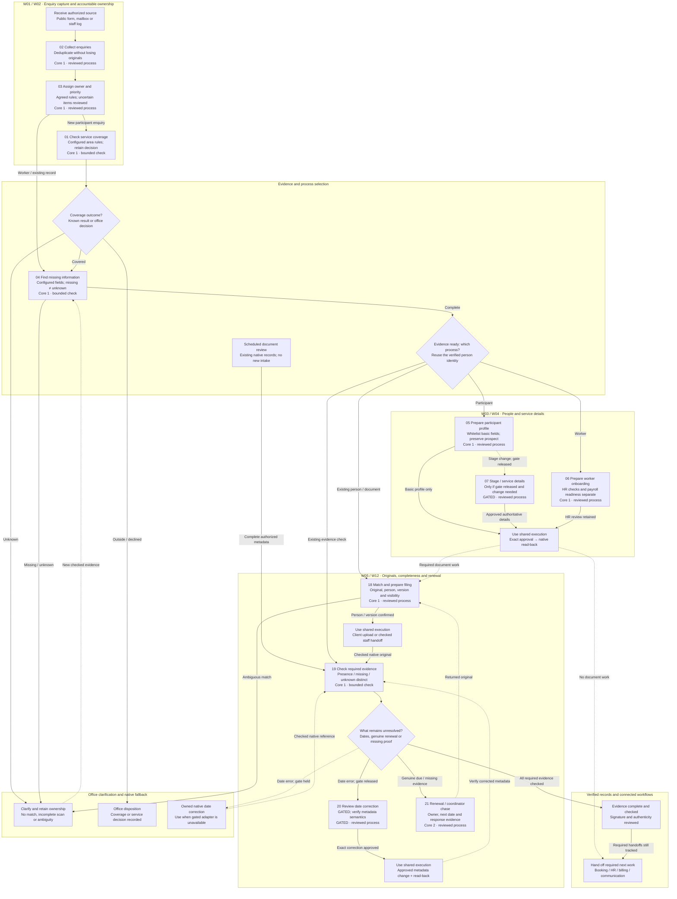
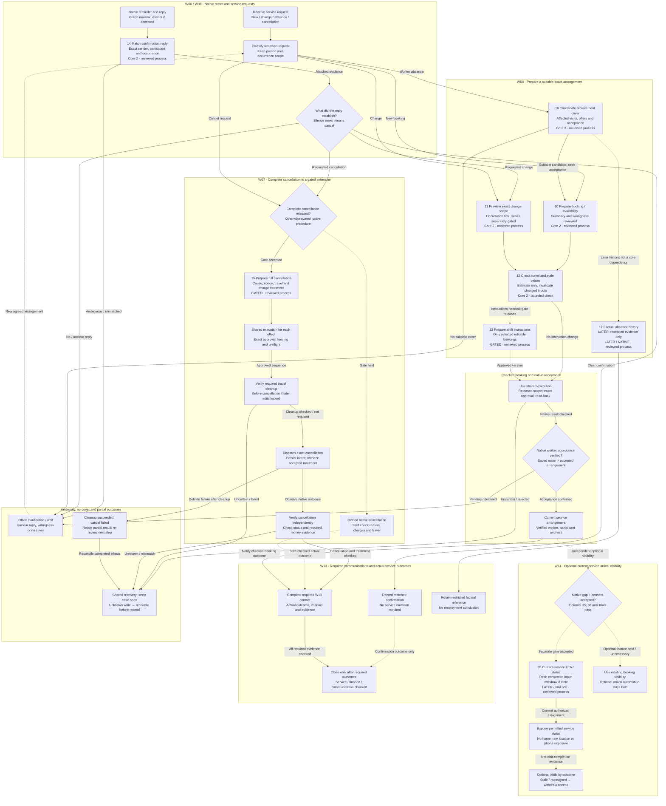
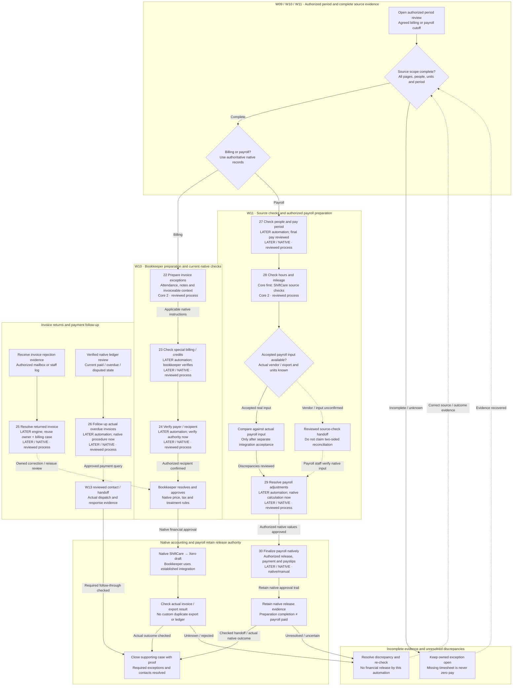
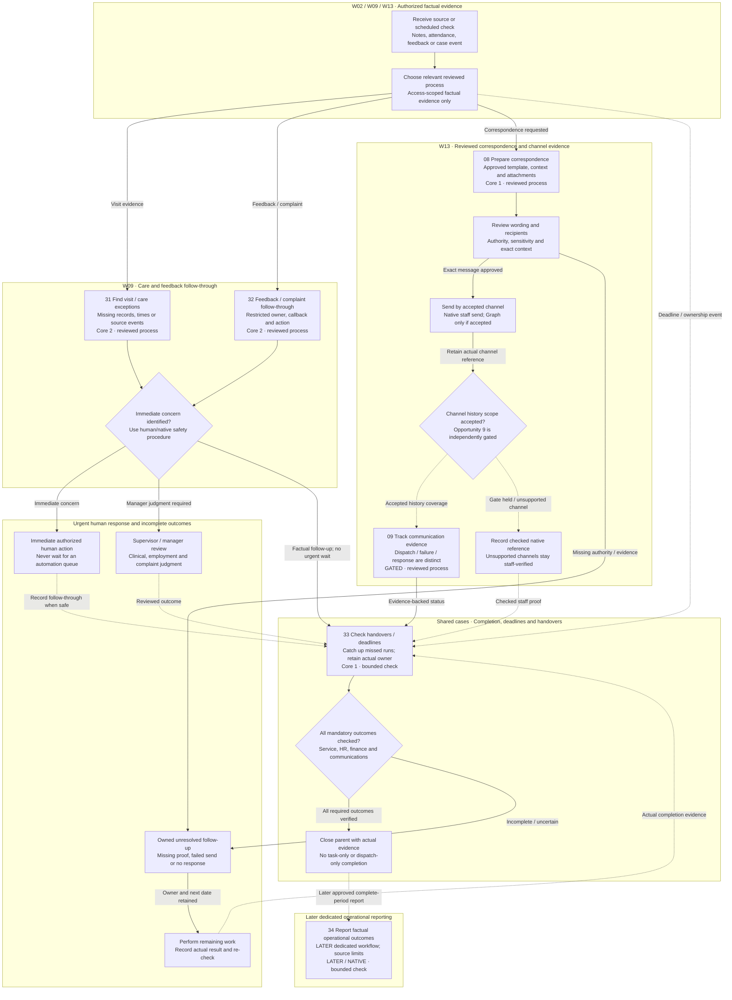

# OCD complete workflow flowcharts

Proposed custom-system process design — 25 October 2026. All 35 opportunities are covered across W01–W14: 20 core, five gated additions and ten later/native dispositions. This is a planning artifact, not proof of live account integration.

[Open the interactive atlas](OCD_Complete_Workflow_Flowchart.html). Nodes show preparation, approval, owned native work, verification, incomplete outcomes and recovery. Dashed edges are conditional/secondary handoffs; they do not assert a vendor webhook.

The shared execution flow applies to each external effect in the business views. Bounded internal checks may run under approved deterministic rules. Native care, acceptance, signing, accounting and payroll retain their own authority.

## OCD proposed execution and recovery

```mermaid
flowchart TB
  subgraph capture["Authorized source and scoped case"]
    trigger["Authorized trigger<br/>Form, Graph, staff log or schedule"]
    capture["Capture and deduplicate<br/>Immutable source and version"]
    scope["Verify case scope<br/>Actor, branch, person and account"]
  end
  subgraph prepare["Evidence and exact proposal"]
    prepare["Run selected process<br/>Use the four business views"]
    evidence{"Evidence complete and fresh?<br/>Unknown is not an all-clear"}
    proposal["Prepare exact proposal<br/>Source, fields, policy and snapshot"]
  end
  subgraph hold["Office clarification and held scope"]
    clarify["Clarify missing evidence<br/>Owner and deadline remain visible"]
    held["Held or native-only scope<br/>No automatic dispatch or closure"]
  end
  subgraph review["Release policy and human approval"]
    release{"Released workflow and method?<br/>Case, account, fields and guards"}
    approve["Approve exact external effect<br/>Current role and auth freshness"]
    method["Select accepted method<br/>Internal, API or checked handoff"]
  end
  subgraph effect["Durable action or checked native handoff"]
    outbox["Commit intent and outbox<br/>Stable action and replay key"]
    preflight["Recheck native state<br/>Permission, locks and current scope"]
    dispatch["Persist fenced dispatch<br/>Before external I/O"]
    native["Call accepted native method<br/>No DB lock held over the network"]
    internal["Record internal check<br/>Approved deterministic rules"]
    manual["Perform owned native step<br/>Record actual checked reference"]
  end
  subgraph outcome["Independent evidence and parent completion"]
    verify{"Outcome independently verified?<br/>API read-back or labelled staff proof"}
    children{"All required outcomes complete?<br/>Travel, finance and communication"}
    done["Close parent with evidence<br/>Preserve source and audit trail"]
  end
  subgraph recovery["Uncertain outcomes and remaining work"]
    stale["Changed state or rejection<br/>Refresh evidence and re-review"]
    reconcile["Reconcile unknown outcome<br/>Read first; never blindly resend"]
    followup["Finish required child work<br/>A task is not delivery evidence"]
  end
  trigger --> capture
  capture --> scope
  scope -->|"Scope verified"| prepare
  scope -->|"Denied / unscoped"| held
  prepare --> evidence
  evidence -->|"Complete"| proposal
  evidence -->|"Missing"| clarify
  clarify -.->|"New version"| prepare
  proposal --> release
  release -->|"Held"| held
  release -->|"External effect"| approve
  release -.->|"Rules-only check"| method
  approve -->|"Approved"| method
  method -->|"Accepted API"| outbox
  method -.->|"Internal"| internal
  method -.->|"Native handoff"| manual
  outbox --> preflight
  preflight -->|"Current"| dispatch
  preflight -->|"Changed"| stale
  stale -.->|"Re-review"| prepare
  dispatch --> native
  native -->|"Observe result"| verify
  native -->|"Definite no-effect rejection"| stale
  manual -.->|"Checked proof"| verify
  internal -.->|"Internal receipt"| children
  verify -->|"Matches"| children
  verify -->|"Unknown / mismatch"| reconcile
  reconcile -.->|"Read-only check"| verify
  reconcile -.->|"Verified no effect; re-review"| stale
  children -->|"All complete"| done
  children -->|"Still pending"| followup
  followup -.->|"Actual evidence"| children
```

**Recovery and security invariants**

- A lost response is not permission to resend a create, cancellation or financial action.
- Cleanup success followed by cancellation failure remains a real partial outcome requiring review.
- After restore: hold normal traffic and dispatch; reconcile current access/privacy changes and newer native effects.
- Every legacy, new and worker path enforces the accepted case/operation/field/guard release manifest.
- Urgent safety response follows the existing human/native procedure without waiting for automation.

## Enquiries, onboarding and documents



**Onboarding and document boundaries**

- W03 participant activation, funding and agreed hours require approved authoritative evidence. Opportunity 7 is optional gated work; it does not block basic core profile preparation.
- W04 basic staff setup does not establish screening clearance, invitation acceptance, sign-in access or payroll readiness.
- W05 signatures remain native/manual. Original filing, valid signatures and a configured completeness check are separate outcomes.
- W12 repairs evidence-backed false dates before scheduling genuine renewal follow-up; native reminder sending is reused where suitable.
- A completed profile or upload does not complete its parent case when HR, billing, renewal or communication children remain.

## Bookings, confirmations, cover and arrival



**Rostering and cancellation rules**

- W06 retains native reminders. Opportunity 14 monitors replies; it does not implement an automatic cancel-on-silence policy.
- W08 initially prepares one-off bookings and accepted occurrence changes. Published recurrence, availability and description APIs still need whitelisted adapters and client-account acceptance.
- Every cleanup and cancellation effect passes shared execution independently. Where native cancellation locks later edits, cleanup is checked first. Unknown outcomes use read-only reconciliation; definite failure after cleanup remains partial.
- No offer, draft booking or matching free time proves worker willingness. Native acceptance and participant agreement remain distinct evidence.
- W14 opportunity 35 is later and optional. Existing approved booking-map support is not permission for continuous worker tracking.

## Invoice checks, payroll preparation and native release



**Native finance and deferred automation**

- Opportunities 22 and 28 are core preparation workflows. The other seven numbered finance/payroll opportunities in this view remain later automation or native/manual processes.
- Later nodes describe staff work that still happens. They do not activate a custom Xero connector, payroll engine, credit allocation, invoice reissue, collection action or money movement.
- ShiftCare native invoice/timesheet exports remain in use. New direct Xero OAuth, organization/contact/invoice matching and payment reconciliation require separate acceptance if later scope is released.
- The payroll vendor remains unconfirmed. Opportunity 28 first provides ShiftCare source completeness, hours and mileage checks plus a reviewed handoff. Two-sided comparison needs the real accepted export/API.
- Period checks never erase leavers with final pay due. An inactive login is not evidence of zero payroll entitlement.

## Care exceptions, correspondence and accountable completion



**Safety, communication and completion boundaries**

- W09 flags factual care-record exceptions. It does not diagnose, score staff, decide misconduct or replace professional care and complaint judgment.
- W13 correspondence preparation does not itself send a message. Native communication remains a supported staff handoff; Graph sending requires separately accepted Mail.Send permission, implementation and release.
- Opportunity 9 does not promise universal cross-channel receipt visibility. A queued task or Graph 202 response is not proof of delivery or acknowledgement.
- Opportunity 33 runs bounded assignment and completion rules. It cannot make staff available, approve work on their behalf or close a case while required outcomes are missing.
- Core pilot instrumentation is retained. Opportunity 34 is a later dedicated report; factual periods and source completeness are labelled without invented savings or forecasts.

## Coverage register

F = bounded automatic function; P = partial automation; N = native/manual handoff. F does not remove the human judgments described in the feasibility register.

| # | Process | Scope | Level | Workflow families |
| --- | --- | --- | --- | --- |
| 01 | Service area screening | Core 1 | F | W01 |
| 02 | Centralized enquiry collection | Core 1 | P | W01, W02 |
| 03 | Enquiry ownership and prioritization | Core 1 | P | W01, W02 |
| 04 | Missing information detection | Core 1 | F | W02, W03, W04 |
| 05 | Participant onboarding and profile updates | Core 1 | P | W03 |
| 06 | Worker onboarding coordination | Core 1 | P | W04 |
| 07 | Client stages and agreed service details | Gated addition | P | W01, W03, W08 |
| 08 | Correspondence preparation | Core 1 | P | W13 |
| 09 | Communication tracking and history | Gated addition | P | W02, W13 |
| 10 | Booking preparation and availability checks | Core 2 | P | W01, W08 |
| 11 | Booking change scope and verification | Core 2 | P | W08 |
| 12 | Travel checking and stale value detection | Core 2 | F | W08, W11 |
| 13 | Shift instruction maintenance | Gated addition | P | W08, W09 |
| 14 | Participant confirmation monitoring | Core 2 | P | W06, W07, W08 |
| 15 | Complete cancellation handling | Gated addition | P | W07, W13 |
| 16 | Absence and replacement cover coordination | Core 2 | P | W08, W13 |
| 17 | Factual absence histories | Later / native | P | W08 |
| 18 | Document matching and filing | Core 1 | P | W05 |
| 19 | Document completeness and attachment checks | Core 1 | F | W02, W05, W12 |
| 20 | Document date and expiry correction | Gated addition | P | W05, W12 |
| 21 | Renewal and coordinator follow up | Core 2 | P | W05, W12, W13 |
| 22 | Invoice preparation checks | Core 2 | P | W09, W10 |
| 23 | Special billing instructions and prepayments | Later / native | P | W10 |
| 24 | Billing recipient verification | Later / native | P | W02, W10 |
| 25 | Returned invoice resolution | Later / native | P | W02, W10, W13 |
| 26 | Payment follow up | Later / native | P | W10, W13 |
| 27 | Pay period and employee checks | Later / native | P | W04, W11 |
| 28 | Timesheet hours and mileage reconciliation | Core 2 | P | W09, W11 |
| 29 | Payroll adjustment tracking | Later / native | P | W11 |
| 30 | Payroll completion handoffs | Later / native | N | W11 |
| 31 | Visit record and care exceptions | Core 2 | P | W09 |
| 32 | Feedback complaint and safety follow through | Core 2 | P | W09, W13 |
| 33 | Task completion handovers and escalation | Core 1 | F | W01, W02, W08, W13 |
| 34 | Operational outcome reporting | Later / native | F | W01, W08, W10 |
| 35 | Arrival visibility if the remaining gap is confirmed | Later / native | P | W14 |

## Sources and validation

The [implementation plan](OCD_Custom_System_Implementation_Plan.md), [architecture and data design](implementation-plan-2026-10-25/architecture-and-data-design.md), [35-item feasibility register](automation-feasibility-2026-10-25/feasibility.json), and [workflow use cases](OCD_Workflow_Use_Cases.md) supply the planning content. The newer plan and feasibility register govern release scope.

[Source hashes and provenance](../.archify/workflow-ocd-complete-20261025-165645/source-manifest.json), [coverage register](../.archify/workflow-ocd-complete-20261025-165645/coverage.json), and [delivery review](OCD_Complete_Workflow_Flowchart_Review.md) accompany the atlas.

Editable Mermaid is supplied here. The offline HTML embeds static SVGs laid out with [Viz.js / Graphviz](https://viz-js.com/api/); no external runtime or automation platform is required to view them.
