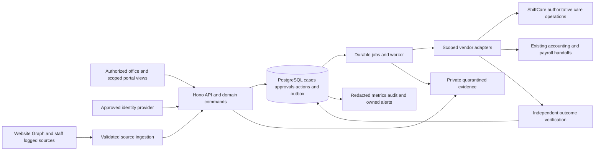

# OCD Custom System Implementation Plan

**Planning baseline 25 October 2026. Status: execution blueprint with explicit unresolved gates. No system implementation or deployment is authorized by this document.**

OCD will extend its existing custom application to coordinate enquiries, evidence, reviewed native actions, exceptions and verified completion. ShiftCare remains authoritative for care operations; Xero and the confirmed payroll platform retain accounting and payroll. The application owns automation independently through its domain services, database, jobs and worker. n8n is not a production dependency.

The initial delivery target is the previously assessed **20 core workflows plus five gated additions**, within the existing W01–W14 families. Five selected opportunities are bounded automatic checks/calculations/routing; 20 retain staff decisions or native handoffs. The remaining ten opportunities receive explicit later/native/manual dispositions. Existing user-requested role-specific Mapbox views remain inherited requirements; optional arrival tracking and the discussed broader portals have separate acceptance gates.

## Deliverables and reading order

| Artifact | Purpose |
|---|---|
| This plan | Scope, seven planning phases, architecture, security, acceptance and execution rules. |
| [Architecture and data design](implementation-plan-2026-10-25/architecture-and-data-design.md) | Components, schema, API contracts, state transitions, data flows and integration boundaries. |
| [Discovery and decision register](implementation-plan-2026-10-25/discovery-and-decisions.md) | 36 owned questions, blocking points and required decision evidence. |
| [Phased task roadmap](implementation-plan-2026-10-25/roadmap.md) / [CSV](implementation-plan-2026-10-25/roadmap.csv) | 83 tasks, including the 35 opportunity dispositions, dependencies, outputs, acceptance and tests. |
| [Requirements traceability](implementation-plan-2026-10-25/requirements-traceability.csv) | 285 source/control entries linked to tasks and validation. |
| [Security and risk register](implementation-plan-2026-10-25/security-and-risk-register.md) / [CSV](implementation-plan-2026-10-25/risk-register.csv) | 36 risks, planned mitigations, residual risks, owners and test references. |
| [Testing and validation](implementation-plan-2026-10-25/testing-and-validation.md) / [case catalog](implementation-plan-2026-10-25/test-catalog.csv) | Layered test strategy and 67 designed scenarios, including each original opportunity. |
| [Deployment and operations](implementation-plan-2026-10-25/deployment-and-operations.md) | Environment separation, pipeline, migration, monitoring, rollout, rollback and recovery. |
| [ASVS applicability register](implementation-plan-2026-10-25/asvs-applicability.csv) | Pinned ASVS 5.0.0 L1/L2 inventory and selected L3 controls, with applicability/evidence still to be assessed. |
| [Final validation report](implementation-plan-2026-10-25/final-validation-report.md) | Separate critical review, revisions, coverage checks and remaining release blockers. |

The task/test/decision identifiers are stable planning references, not evidence that a feature or test has been implemented. Every dependency and acceptance condition in the roadmap must be satisfied or explicitly re-planned before the relevant release.

## 1 Requirements and discovery

### Evidence and precedence

Use the [27-item client register](OCD_Automation_Requirements_Register.csv), [96 recorded pain points](pain-points-2026-10-23/pain-points.json), [35 opportunities](automation-opportunities-2026-10-24/opportunities.json), [feasibility decisions](automation-feasibility-2026-10-25/feasibility.json), original transcript references and the existing W01–W14 use cases. Retain the distinction between direct requests, discussed features, team proposals, broader business wants and later user instructions.

The current code snapshot is evidence of implementation, not proof of production acceptance. Newer account trials can supersede earlier capability assumptions, but do not silently change business requirements. Existing diagrams provide conceptual relationships; older NestJS or GET-only labels do not override the current Hono backend and opt-in write adapters. The execution lifecycle specification is retained as a specification, without claiming that an HTML export exists.

The [traceability matrix](implementation-plan-2026-10-25/requirements-traceability.csv) covers all 27 register entries, 96 pain points, 35 opportunities, 35 transcript work groups, 57 secondary findings and 35 technical/control requirements. Coverage means a source has an explicit implementation or disposition path; it does not mean OCD has confirmed that every historical practice is still current.

### Discovery activities and exits

Tasks T-D01–T-D06 re-walk representative enquiry, participant, worker, document, roster, cancellation, invoice and payroll cases with their actual owners. Record the original input, systems opened, decisions, exceptions, handoffs and proof of completion. Measure repeated handling and errors before setting benefit targets.

Validate account access and native feature fit before choosing custom writes: exact ShiftCare account/region/entitlement; supported fields and locked states; native Inbox Signals/Referrals trial; native reminders; existing signing; native financial exports; and actual payroll vendor. Approved designated test records and separate credentials are prerequisites for future mutation trials. Assistant MCP authorization is not a website credential.

Resolve the seven original clarification themes: payroll calendar, carried payslip field, travel/mileage rules, missing intake date, certificate task, report fragment and employee contract. The brief fragments do not authorize new modules or guessed rules. Confirm observed Tuesday invoicing and fortnightly payroll rather than hardcoding historical statements as current policy.

Q01–Q36 define remaining questions, owner roles, evidence and gates. Critical dependencies include identity/MFA, scope/role rules, cancellation travel treatment, native concurrency, privacy/retention/processor approval, migration authority, support coverage and recovery targets. The proposed design may be refined while these are open; affected real-data exposure and native actions remain blocked.

### Scope and business ownership

| Scope | Original numbers | Treatment |
|---|---|---|
| First core ten | 1, 2, 3, 4, 5, 6, 8, 18, 19, 33 | Intake, reviewed onboarding, document work, communication preparation and owned completion. |
| Second core ten | 10, 11, 12, 14, 16, 21, 22, 28, 31, 32 | Rostering, travel checks, confirmations, cover, renewals, financial preparation and factual follow-up. |
| Five gated additions | 7, 9, 13, 15, 20 | Stages/hours, communication evidence, instructions, complete cancellation and expiry correction. |
| Later/native/manual | 17, 23, 24, 25, 26, 27, 29, 30, 34, 35 | Dedicated HR history/reports, deeper ledger/payroll work, native payroll completion and optional arrival. |

The first 25 remain the same original opportunities; shared jobs, components and checks are not counted as extra workflows. A gated item can move earlier if its actual dependencies and release evidence pass. Target25 is achieved only when all five additions satisfy their scoped acceptance criteria.

Keep native worker time/care entry, worker acceptance, payroll calculations/release, signing and accounting exports. Do not add an ATS, LMS, campaign engine, full CRM, generic workflow builder, independent care-data warehouse, new signing service or payroll engine. Hiring, staffing capacity, competence, phone/audio fixes, contract classification and supplier administration retain named human/native owners under T-GOV02.

### Proposed roles and decisions

OCD nominates actual people for product/operations ownership, bookkeeper/payroll, HR/document review, care supervision, privacy accountability and native account administration. Engineering needs a technical lead, integration/data engineers, QA, a security reviewer and a named service maintainer with backup. These are accountable functions, not a claim that OCD has hired separate people for every role. Explicitly document combined roles and conflicting privileges.

Architecture decisions already fixed by the conversation: custom ownership, internal operations/future branches, native authority and scope discipline. Decisions still open: identity/hosting/job product, workload/SLOs, data/legal policies, exact role assignments, source/write support and optional portal/arrival activation. Do not procure providers or assume licence availability from this plan.

## 2 System architecture and design

### Overall topology

Use one modular TypeScript application codebase, retaining the React office workspace and Hono API. Operate API and background workers as separate processes when deployed. PostgreSQL stores business records and durable job/outbox state; private evidence storage retains necessary originals. The existing private PostgreSQL byte storage can serve a bounded initial release if capacity/recovery tests pass; choose private object storage when the measured file workload warrants it. Both use the same protected evidence contract. A mature PostgreSQL job library is a candidate, subject to compatibility and failure tests under Q09. No distributed business transaction spans vendors.

The diagram is the proposed architecture. It extends the [existing workflow map](../.archify/architecture-ocd-all-14-workflows-20261008-223845/ocd-all-14-workflows.html) and [execution specification](../.archify/workflow-ocd-automation-execution-20261008-223845/candidate.json). It is not a deployment receipt.

### Modules and responsibilities

| Module | Responsibility |
|---|---|
| Identity and access | OIDC/MFA, revocable sessions, capabilities, branch and person relationships, service identities. |
| Intake and sources | Service-area checks, website/mail collection, immutable source versions, provenance and triage ownership. |
| Cases and policy | W01–W14 typed case logic, exact proposals, policy versions, approvals and required outcomes. |
| Jobs and reconciliation | Durable preparation/dispatch/verification, fencing, schedules, retry budgets, uncertain outcomes and parent completion. |
| People and documents | Reviewed native identity/basic fields, originals, document requirements, filing and expiry evidence. |
| Rostering and continuity | Scoped booking proposals, current availability evidence, native acceptance, travel estimates, cancellation and cover. |
| Finance preparation | Complete-period evidence, units and exception preparation; existing native accounting/payroll handoffs. |
| Communication and follow-up | Approved templates, native handoffs, authorized history references, response/delivery states and owned follow-up. |
| Views and maps | Role-safe projections of current native records; retain approved map behavior without duplicate care entry. |
| Operations | Audit, redacted telemetry, controlled configuration, backups, migration and support tools. |

### Data and API design

Normalize the current account JSON state into scoped source, case, proposal, approval, action/attempt, receipt, dependency, file, policy, schedule and connector records. Preserve native IDs as `(provider, connector account, entity kind, external ID)`; a numeric native ID alone is not globally unique. Internal organization/branch boundaries do not automatically equal ShiftCare accounts or Xero organizations.

Unassigned enquiries may enter an explicitly authorized central triage scope with an owner/deadline. They must acquire a validated branch/connector binding before external mutation. Branch-null is never shorthand for public or all-branch access. Composite constraints, application authorization and tested row-level policies enforce scope, including pooled DB connections and background jobs.

The [data design](implementation-plan-2026-10-25/architecture-and-data-design.md) specifies records, indexes, states and proposed HTTP contracts. Retain compatibility with the current shared-workflow route while introducing versioned typed commands. Never expose a generic arbitrary vendor-path proxy or accept privileged fields from source documents.

### Execution and events

Capture source/version → match scope/person/occurrence → prepare exact proposal → resolve uncertainty → approve version → record action intent → queue → recheck permission/policy/native state → persist dispatch → execute accepted native operation → independently verify → finish required handoffs → close parent case.

Commit business state and an outbox event atomically. The relay and consumers tolerate repeated delivery using stable event/action keys. No network call is held inside a database transaction. Retries of safe reads use bounded backoff/jitter and vendor Retry-After; a definite native rejection blocks the action. An uncertain native write enters reconciliation and is not blindly resent. An expired worker lease cannot authorize a competing write to the same target.

All native actions retain exact approval. Bounded internal checks can complete under approved deterministic rules without a person clicking every read. Source, policy, relevant native snapshot or permission changes invalidate a pending approval. Dispatch also checks a release manifest binding the accepted case/opportunity, account, operation, fields and required guard/policy versions. Legacy routes and worker credentials cannot enable a held cancellation/ETA or other workflow merely because its raw native method is accepted. The system does not claim externally exactly-once effects or eliminate races with ShiftCare users where the vendor lacks conditional-write support.

### External integrations

ShiftCare adapters use accepted account/region credentials and field-specific contracts. Native recurrence, instruction, event, availability and invoiceable interfaces are documented in the [25 October API evidence](automation-feasibility-2026-10-25/api-evidence.json); only validated subsets enter enablement. Availability patterns require expansion and still do not prove willingness. General staff-file corrections, broad chat history/sending and unverified fields stay checked native steps.

Graph uses the approved mailbox/folders, immutable IDs and persisted delta checkpoints. Advance a page cursor only with committed source records. Native SMS reminder replies can arrive by admin email; actual formats and identity/occurrence matching need trials. Mail.Send and additional folders require separate accepted scope; Inbox read access does not authorize sending.

Use native ShiftCare–Xero invoice/timesheet exports and verified accounting/payroll handoffs. A01 onboarding includes a distinct accounting readiness check. Direct Xero OAuth reads for balances, recipient/payment reconciliation are later work, not assumed existing integration. Xero accounting does not establish Xero Payroll. No application pay release is proposed.

Use private file storage, accepted identity, hosting, routing and optional scanning services as necessary technical dependencies. Existing Mapbox can provide maps/estimates under its accepted privacy scope; it does not supply worker location. Local OCR is the default extraction path. Any external AI processing is optional and disabled until purpose/vendor/terms/data scope approval; extraction never receives privileged tools or authority to dispatch.

### Special workflow gates

For AUTO-15, approve and verify required provider-travel/mileage cleanup before cancellation when native post-cancel edits are restricted. Persist each child action. Cleanup success followed by cancellation failure, unknown result or failed communication remains an open case; do not assume rollback can undo native effects.

For AUTO-22, use native invoiceable evidence/pricing and cursor-aware reads, not a new billing calculator. For AUTO-28, deliver ShiftCare completeness/quantity checks and a reviewed handoff; claim two-sided payroll reconciliation only after the actual export/API is connected. Missing evidence is not zero pay. For AUTO-09, dispatch acceptance, receipt, acknowledgement and response are different states. For AUTO-20, reviewed metadata corrections must not hide genuine expiry.

## 3 Implementation roadmap

The [83-task roadmap](implementation-plan-2026-10-25/roadmap.md) is the execution backlog. Each task has an owner role, explicit predecessors, deliverable, acceptance condition, test references and open-decision links. Tasks for the ten later opportunities establish a disposition and responsible native process, not authorization to build those features.

| Phase | Work and dependencies | Milestone and exit |
|---|---|---|
| P0 Discovery and scope | T-D01–T-D06 and T-GOV01; start from original evidence and current native work. | **M0:** current dispositions, rule samples, data/role boundaries, API proof plan, inherited features and workload questions recorded. Relevant unanswered questions block downstream activation. |
| P1 Architecture and secure foundation | Architecture, identity/authorization, normalized records, evidence, jobs/outbox, adapters, CI/env design and recovery foundation. | **M1:** architecture/applicability decisions accepted; identity/scope, typed commands, duplicate/failure handling, synthetic migration/restore and test harness proven before real data. |
| P2 First core ten and pilot | C1 AUTO tasks after their foundation dependencies; T-GOV02, T-QUAL02–04, T-OPS05 and T-REL01–02. | **M2:** ten scoped workflows accepted; restricted read-only pilot first, then witnessed accepted operations only. No live mutation before current-release security, privacy, support and recovery gates pass. |
| P3 Second core ten | C2 AUTO tasks, inherited maps/portal acceptance, T-QUAL05 and T-REL03. | **M3:** core20 accepted with complete-source checks, native handoffs, permissions, urgent fallback and measured support behavior. |
| P4 Five gated additions | AUTO-07/09/13/15/20, per-addition contract/policy proof, T-QUAL06 and T-REL04. | **M4:** target25 only when all five gates pass. A held addition is reported honestly; it is not replaced by counting an internal job as another workflow. |
| P5 Branches and sustained operation | T-OPS06–07; branch expansion after core acceptance and actual branch/account mapping. | **M5:** cross-branch denial, per-account budgets, schedule/capacity and support/recovery acceptance before another branch receives access. |
| P6 Later/native review | AUTO tasks for 17/23–27/29/30/34/35 remain disposition tasks. | **M6:** pursue only separately approved remaining gaps; payroll completion stays native, ETA remains conditional, and original human/process remedies remain owned. |

Phases indicate delivery priority, not a requirement to serialize independent work. Dependency order and security gates prevail. No calendar/currency commitment is made without the actual team, workload, access and budget. T-D05 supplies those inputs for later estimates.

## 4 Security and reliability

Use [OWASP ASVS 5.0.0](https://asvs.owasp.org/) L1/L2 as the proposed verification target, plus selected higher-level checks relevant to exports, risky approvals and resource handling. The register enumerates 253 L1/L2 IDs and four selected L3 IDs. Applicability, control-specific tests and evidence remain work under T-A03; the enumeration is not an ASVS pass or certification. The [API Security Top 10](https://api-security.owasp.org/editions/2023/en/0x11-t10/) supplies additional abuse-case framing.

Production authentication should use an accepted maintained OIDC provider, preferably the existing Microsoft tenant if it can enforce required MFA and lifecycle controls. Validate issuer/audience/state/nonce/PKCE, use revocable opaque server sessions, rotate at authentication/privilege changes, and require accepted fresh authentication for sensitive actions. The current environment-password office login is a prototype gap. Timeout and second-approver thresholds need Q08/Q33 rather than becoming invented business policy.

RBAC is combined with branch, person relationship and field authorization. Proposed capability templates include triage, rostering, HR/documents, bookkeeping, care supervision, read-only scoped review and platform operation. Platform administration does not automatically imply access to every care/payroll payload. Enforce permissions on every case, file, native lookup, export, command and job. Avoid self-service scope changes through request fields.

Protect unsafe browser requests with CSRF tokens and explicit origins; configure trusted reverse proxies rather than trusting arbitrary forwarded headers. Use secure HttpOnly host cookies, HTTPS/HSTS, restrictive CORS and a tested CSP compatible with required map assets. Render untrusted content as text or sanitized content, parameterize queries and reject unknown/privileged input fields. Escape spreadsheet formula cells in exports as well as correct CSV quoting.

Store secrets only server-side in an approved secret facility; separate runtime, migration, worker and deployment credentials by environment. Prefer narrower vendor scopes where supported, while documenting native key limitations. Use verified TLS to DB/vendor endpoints, encrypted storage/backups and recoverable managed key access. No raw secrets, care notes or financial payloads belong in operational logs or browser bundles.

Uploads enter private quarantine. Apply filename/path normalization, MIME/signature/size/page checks, malware controls, isolated resource-limited OCR and strict remote-download destination validation. Protect against SSRF, redirects, private/metadata IPs and DNS changes; an allowlisted URL alone is not sufficient. Source text is untrusted data, including instructions embedded in forms or email. Optional extraction output must have typed fields and evidence, never tool authority.

Audit records retain server-derived actor, source/proposal/policy versions, intended native effect, dispatch, independent receipt and actual handoff evidence. App roles cannot edit historical approvals/audit; sensitive details remain restricted. Tamper-evident export/storage and separated privilege reduce risk but do not make privileged operators or vendor attribution infallible.

Reliability uses transactional local state, stable replay keys, per-target dispatch exclusion, worker fencing, bounded read retries, explicit unknown-write reconciliation, source completeness and aggregate completion. Use per-account quotas, workload classes and backpressure so OCR/backfill cannot starve urgent cases. Schedules have approved timezones/anchors and missed-run policies rather than silently processing only the current day.

The [risk register](implementation-plan-2026-10-25/security-and-risk-register.md) keeps all mitigations in planned status. Residual risks include vendor outages/permissions, native edit races, eventual consistency, imperfect source/extraction accuracy, delivery uncertainty, privileged provider access, operator mistakes and staffing/support capacity. No complete-security claim is made. Exploitable critical/high issues, unacceptable sensitive-data paths and unowned recovery/urgent coverage block release; remaining exceptions require named, time-bounded acceptance and compensating controls.

## 5 Testing and validation

The [test strategy](implementation-plan-2026-10-25/testing-and-validation.md) defines unit, real-PostgreSQL integration, vendor contract, E2E, business UAT, security, performance and failure-recovery layers. The 67-case catalog is a designed suite, not a statement that these tests ran. Existing 24 October build/47 isolated-test evidence remains limited historical regression evidence.

Every selected AUTO task has its own acceptance case and joins common negative/failure cases. Exercise missing/invalid data, duplicate/out-of-order sources, identity ambiguity, permission denial, source/policy changes, multiple workers, stale native state, partial collection, unsafe uploads and partial business outcomes. Contract tests include actual accepted permissions and native state/field semantics. Trial mutations use explicitly authorized designated records and independent read-back.

Failure scenarios include API 401/403/409/422/429/5xx/timeouts; a remote success with lost response; a worker crash before/after dispatch; cleanup success followed by cancellation failure; failed communication after native success; Graph cursor expiry; DST/missed schedules; DB/storage loss; rollback with in-flight calls; and restore after a later native effect. No scenario may report false completion or authorize a blind resend.

Performance acceptance uses the Q11-approved profile at 1x and 2x expected peak plus outage backlog. Measure API latency, queue age, urgent-work delay, vendor budgets, storage/OCR use, backlog-drain time and errors. Specific thresholds and recovery targets require approval; do not substitute arbitrary staff/branch counts for measured demand.

## 6 Deployment and operations

Development uses synthetic data and local services. Staging has separate databases, buckets, credentials, identity configuration and approved vendor test scopes. Production receives no development personas, seeded accounts, implicit local-file fallback or broad staging credentials. Any use of real data in staging needs approved minimization and access controls.

Prefer a host topology supporting a persistent API, separate worker, managed PostgreSQL and private evidence storage in an accepted region. The current Vercel/static delivery can be retained where appropriate, but bounded functions cannot host an endless worker loop. Hosting remains Q16; the deployment guidance from the [use-railway skill](</home/rovic/.agents/skills/use-railway/SKILL.md>) informed environment/service separation and observed-success requirements without selecting or provisioning Railway.

The future pipeline builds once from locked inputs, runs the required tests/scans, records artifact/schema/job versions, rehearses migration, deploys staging, runs smoke/contract/security acceptance and promotes the same digest through a protected release. Record the actual deployment identity/status, readiness and worker/source checks before reporting success. Pipeline files and infrastructure are not created by this planning task.

Use new numbered, checksum-preserving migrations. Inventory the selected legacy store, backup before cutover, transform in bounded batches, compare retained records/evidence hashes, stop old writers and move pending external work into reconciliation hold. Existing applied migrations must not be edited. The current all-transaction migration runner needs an explicit strategy if nontransactional online indexes are required.

Monitor worker heartbeat, source freshness, overdue unassigned work, queue/reconciliation age, API errors/quotas, delivery failure and backup freshness with redacted case references. Alerts have a named primary/backup and an exercised route. Runtime health must not expose credentials or payloads, and a vendor outage should not create an uncontrolled restart loop.

Backup the database, evidence versions, configuration and necessary encryption-key access consistently. Proposed starting recovery targets are **RPO 15 minutes and RTO 4 hours**, subject to Q16 feasibility/cost/owner approval; they are not a service commitment. Measure actual restore behavior. After restore, isolate normal traffic, invalidate restored sessions and reconcile current access/consent/privacy changes as well as native effects newer than the checkpoint before normal reads or dispatch resume. Restoring a DB does not rewind ShiftCare or Xero.

Rollback stops new claims, drains or marks uncertain calls, reverts only compatible code/config and preserves schema/receipts. Native changes need explicit reconciliation or approved correction, not automatic compensation. Support includes access/key review, dependency/vendor contract monitoring, restore drills, incident/near-miss review and measured cost/benefit reassessment.

## 7 Separate final plan review

After drafting, perform a separate source/architecture/security/operability review recorded in the [final validation report](implementation-plan-2026-10-25/final-validation-report.md). Check source-to-task-to-test links, scope dispositions, inherited maps, unresolved native assumptions, dependency cycles, approval/lease/restore semantics, manual boundaries and release gates. Challenge the plan against abuse and failure cases rather than relying on coverage counts alone.

Revise planning gaps and repeat structural/semantic validation. A critical item can remain unresolved only with a precise question, accountable owner role, blocked action and required evidence. That documents a planning dependency; it does not authorize releasing the unresolved risk. Name the actual people before execution and attach future test/UAT evidence to the stable IDs.

The blueprint is ready to guide discovery and controlled implementation planning once reviewed by the project owners. It is not permission to start implementation in this turn, an acceptance of outstanding business rules, a deployment approval, or a claim that the current prototype is secure or production-ready.
