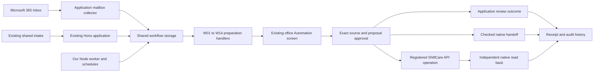

# Native automation implementation for OCD Brilliance

The existing web application has a shared backend workflow runtime for W01–W14. It extends the Hono/TypeScript application and React office interface. ShiftCare remains authoritative for care records, staff, client profiles and rostering; accounting and payroll retain their existing approval/export processes. The current worker collects sources and prepares cases. Staff use the application API to review, approve, execute supported actions and verify outcomes; a general durable worker for approved-action execution remains delivery work.

The implementation includes mailbox attachments and local OCR, bounded ShiftCare evidence collectors, document filing and metadata adapters, staff communication handoffs, review periods and deadlines, and authenticated worker/participant service access. Native changes require exact office approval and independent verification. Live activation requires the client’s credentials, approved mappings and policies, and account acceptance trials. Outbound communication follows the selected staff handoff through ShiftCare.

## Selected implementation direction — 24 October 2026

**Decision:** OCD has selected the custom supporting application to own automation for its internal operations, including future branches. n8n is outside the selected delivery architecture. This supersedes earlier proposals that placed n8n in the primary execution path. The existing n8n drafts remain research references.

The decision selects the platform and ownership of execution. It does not establish untested native capabilities or approve unresolved business rules. The [32-page assessment](OCD_Automation_Architecture_Assessment_2026-10-24.pdf) and [96-item opportunity matrix](automation-assessment-2026-10-24/opportunity-matrix.csv) provide the evidence and per-item treatment. Use the existing W01–W14 definitions and diagrams, with the implementation inventory below distinguishing current behaviour from delivery work.

The [25 October feasibility assessment](OCD_Automation_Feasibility_and_Priorities_2026-10-25.pdf) and [35-item planning matrix](automation-feasibility-2026-10-25/feasibility-matrix.csv) recommend 20 core opportunities and five additions after their individual acceptance gates. These are scoped business workflows within W01–W14. The assessment distinguishes bounded automatic checks from reviewed actions and records current public API capabilities separately from existing adapters and live account acceptance.

| Owner | Responsibility |
| --- | --- |
| Custom application | Authorized sources and versions, person/occurrence matching, cases, exact proposals and approvals, durable jobs, deadlines, external-ID links, exceptions, verified results and audit history. |
| ShiftCare | Authoritative people, roster, worker acceptance, attendance, care records, native documents and service billing records. Use native functions and supported API operations. |
| Xero and confirmed payroll platform | Accounting contacts, invoices, credits, payments and the applicable payroll calculations, approvals and release. Reuse the existing ShiftCare–Xero export path. |
| OCD staff | Identity ambiguity, worker suitability and acceptance, participant agreement, financial treatment, care and employment decisions, and unsupported native steps. |

### Target application components

Extend the current codebase as one modular application. Run its API and background worker as separate processes when production operation requires it. Use PostgreSQL for queryable case, source, approval, action/attempt, history and connector records; use a mature durable job library for execution. Select and validate that library during foundation work. Protected evidence storage retains originals, hashes and permitted access. Vendor adapters remain inside the application, sharing the same policy and authorization checks as office actions.

The execution path is source capture → matching → preparation → review → approval of the exact version → queued action → native preflight → dispatch → independent verification → required handoffs → closure. Persist dispatch before the external request. Reconcile an uncertain write outcome before another dispatch; retrying a job must not create a duplicate native action. Keep business history independently of job retention.

Branch scope belongs in cases, files, permissions, schedules and vendor-account mappings. Branch-specific access must be enforced before a branch receives access. Shared workflow configuration supports expansion; separate copies of the application or workflow logic are unnecessary for the identified requirements.

### Delivery sequence and completion criteria

These are implementation stages, not claims of completed production functionality or new workflow requirements.

| Stage | Delivery work within the identified scope | Completion criteria |
| --- | --- | --- |
| 0 — Rules and native configuration | Confirm actual API access, forms/fields, approved source scope, cancellation/travel rules, financial periods, payroll vendor, native exports and named maintenance ownership. | Each enabled operation has an agreed rule, supported native method and responsible reviewer. Unresolved questions remain visible. |
| 1 — Shared foundation | Replace the single account JSON row with indexed case/action/history records using a deliberate migration; add durable approved-action jobs, recovery, missed-run policy, protected evidence access and monitoring. | Duplicate input, changed approvals, concurrent dispatch, worker restart and unknown native outcomes recover without duplicate effects or false completion. Existing evidence/history are preserved and the migration is verified before cutover. |
| 2 — Intake, onboarding and documents | Reuse Graph/shared intake, source evidence and extraction; complete reviewed participant/worker matching and document handoffs in W01–W05/W12. | A representative intake reaches a checked native result with original evidence retained; ambiguous identities remain blocked and accounting/payroll readiness is checked separately. |
| 3 — Roster and operational follow-through | Complete scoped replies, cancellations, cover, care exceptions and communication handoffs in W06–W09/W13. | Verify the correct occurrence, current native state, travel/mileage treatment, required acceptance and actual communication evidence. No cover, failed delivery and unsupported actions remain owned exceptions. |
| 4 — Financial reconciliation | Reuse native exports; complete period checks, invoice/recipient/payment exceptions and payroll-preparation handoffs in W10–W11. Add direct Xero status integration only where the agreed workflow requires it. | Native IDs, period totals and existing export ownership reconcile. No duplicate invoice/export or automated pay release is introduced. |
| 5 — Branch expansion and optional arrival | Apply branch/account/organisation mappings, scoped access and scheduling to the shared workflows. Accept W14 separately on real devices if the existing arrival requirement proceeds. | Cross-branch access is denied; account routing and missed schedules are tested. Arrival requires its own device, privacy and freshness acceptance. |

Branch isolation is a prerequisite to branch access even if the expansion stage occurs later. Measure handling time, corrections, overdue cases, queue age and recovery effort before broadening rollout. The scope remains the identified operational workflows; it does not add a CRM, payroll engine, recruitment system, training platform or marketing engine.

### Current gaps that govern implementation

- The current PostgreSQL runtime locks one account JSON state row and caps retained jobs. Growing cases/actions/history require separate records and tested migration.
- The current worker prepares cases; durable asynchronous execution and verification of approved actions require additional implementation.
- W07 currently cancels the native shift without provider-travel/mileage cleanup. Verified cleanup or an explicit checked native step is required before end-to-end cancellation completion.
- Automatic outbound delivery and a direct Xero OAuth/status connector are not implemented. Retain current staff communication and native accounting handoffs until their scoped replacements are accepted.
- Branch authorization, missed-run recovery, larger-source completeness and real account behaviour require acceptance before expanded operation.

The 24 October review passed the backend build and 47 isolated automation tests using synthetic/mocked operations. These checks establish local regression evidence, not live account acceptance, production load capacity or completion of the stages above. Recording this decision changes the implementation direction; it does not enable connectors or execute native actions.

## Architecture and existing components

| Component | Existing behaviour | Extension |
| --- | --- | --- |
| Frontend | React renderer around the existing workspace; hash routes; local fictional office/worker/client records | Office → Automation → Shared workflows reads authenticated server cases, displays sources and proposals, and submits revision-checked reviews. Browser demo records are never imported. |
| Hono/TypeScript backend | Operations and Journeys routes behind the local server and Vercel adapters | `/api/automation` runs within the same application and uses the existing staff sessions, roles and origin checks. |
| Intake | Source-preserving drafts, local PDF/OCR review, owners, duplicate checks, exact manual handoff approval | The collector reads genuine shared intakes and prepares W01 or W03 cases. PostgreSQL now backs the existing intake repository when `DATABASE_URL` is configured. |
| Workflow engine | Browser-only fictional native snapshots and sample transitions | `backend/automation` implements account-scoped server jobs, source replay prevention, leases, handlers, schedules, approval hashes, dispatch records and outcome receipts. |
| Storage | Local files or shared Redis; PostgreSQL schema/migration tooling existed without intake runtime wiring | PostgreSQL or existing Redis stores shared job state; local development uses atomic files with process locks. No data migration happens implicitly. |
| ShiftCare | Office-only API reads for clients, staff and shifts | Opt-in official API v3 adapters add client create/update, staff create/update, single-occurrence cancellation and a guarded one-client/one-worker assignment/time update. |
| Mail | Fictional messages and manually entered email sources | Microsoft Graph application authentication and Inbox delta polling persist cursors with deduplicated W02 cases. Supported file attachments are retained privately and extracted locally. Original Outlook links and extraction warnings remain visible. |
| Journeys and communication | Existing consented journey simulation, map views and demonstration push | Staff use ShiftCare for communications; W13 records actual history evidence separately from task creation. Verified service accounts read their own native bookings and can submit office requests. Consented device updates calculate an ETA without retaining raw coordinates. |



The worker is an application process. Local `npm start` runs it inside the server unless `AUTOMATION_RUN_WORKER=false`. A persistent production Node server can enable `AUTOMATION_RUN_WORKER=true`, or run `npm run automation:worker` as its own application process. A host scheduler can instead invoke the protected tick endpoint. Vercel functions process bounded batches; they do not host an endless worker loop. A continuously running worker belongs on a host that supports persistent Node processes. Both deployment modes execute the same application code.

## Workflow implementation map

| Workflow and client need | Implemented application behaviour | Native or human responsibility |
| --- | --- | --- |
| **W01 Area and ownership — A02/A03** | Postcode screening, genuine intake collection, ownership, explicit deadlines and overdue follow-up. Adjacent areas remain review cases. | Office confirms actual capacity and contact; coverage does not reserve a worker. |
| **W02 Email triage — A03** | Microsoft 365 delta ingestion, stable source versions, original-file import, PDF/image/text extraction, category and urgency suggestions, reviewed downstream routing and identity candidate reads. Reminder replies retain exact or ambiguous occurrence candidates. | Staff confirm the person, invoice and reply occurrence. Unsupported files and oversized imports link back to Outlook. |
| **W03 Participant onboarding — A01** | Reviewed source fields, labelled names/DOB extraction, duplicate candidates, approved optional profile mappings, gated client create/update, independent profile read-back and original-intake linking. | Actual forms/mappings and native feature gaps require office approval. Service/funding setup and the existing Xero contact are checked separately. |
| **W04 Worker onboarding — A01** | Reviewed worker fields, native identity checks, gated staff create/update and independent verification. New profiles have staff role, no access and no invitation. | HR verifies qualifications, employment settings and the existing payroll setup before work approval. |
| **W05 Agreements and filing — A10** | Outstanding-document follow-up, private original files, checked person/version/signature/category/visibility, gated native client upload, metadata read-back and original/native SHA-256 comparison. | Signing stays with the existing provider/templates. Images and unsupported native file types use staff filing. Download hosts must be configured for byte verification. |
| **W06 Reminder responses — A04/A11** | Reviewed yes/no/change/cancel replies tied to one occurrence, with separate W07/W08 follow-up. Multiple quoted occurrence references remain ambiguous. | Native reminders continue. Staff verify real reply identity and threading; no response does not cancel a service. |
| **W07 Cancellation — A04** | Exact policy/reason/charge review, current-record checks, invoice/approval/group protection, persisted dispatch and independent cancellation verification. | Office confirms actual notice and charge rules. Provider-travel/mileage cleanup is not implemented and requires a verified native step or accepted adapter before the complete cancellation process can close. Unsupported or financially locked occurrences remain native office/bookkeeper decisions. |
| **W08 Booking changes and cover — A05/A06** | Worker acceptance and participant agreement, source snapshots, native roster overlap/leave checks, optional required qualifications, guarded assignment/time update and separate pay-group verification. | Staff select suitable cover through the native roster and confirm personal availability. Group/vacant/new bookings and series changes stay in ShiftCare. |
| **W09 Visit and care exceptions — A08** | Explicit-period reads of shifts, attendance and progress notes; worker-specific clock times, missing notes, duration discrepancies and source incident/injury flags. Failed/paginated reads block an incomplete report. | Workers keep native care entry. Office follows existing care escalation and checks original notes; financial/clinical decisions are not inferred. |
| **W10 Invoice review — A09** | Scheduled or requested review periods, bounded attendance/note/invoice reads, payer/funding evidence and owned discrepancy lists. | Bookkeeper checks actual recipients, rates and exceptions, then uses the existing ShiftCare–Xero approval/export process. |
| **W11 Payroll review — A09** | Explicit fortnight anchor and review period, current attendance/pay-item reads, kilometre/travel unit checks and missing-pay-item warnings. | Pay/award rules, contractor treatment and final release stay with the existing payroll process. Missing evidence is never treated as zero. |
| **W12 Document cleanup — A07** | Scoped staff file/qualification collection, verified non-expiring classification, invalid/missing/expired/due-soon evidence, and guarded client-document/qualification expiry corrections with snapshots/read-back. | Genuine staff-file corrections and renewal communication remain checked native handoffs; the application does not invent a never-expiring date or suppress warnings without evidence. |
| **W13 Communication — A11** | Owned ShiftCare staff handoffs, optional approved native action-item creation/read-back, and a required actual communication history reference before closure. | Staff communicate in ShiftCare. A created task is not delivery evidence. Microsoft 365 is read-only; no automatic outgoing messages are sent. |
| **W14 Arrival — A12/L01** | Separate verified service identities, native booking membership on every request, worker consent, device input, confident service-address routing, fresh ETA projection and withdrawal on reassignment/staleness. | Enable only after privacy/device acceptance. Current support is one participant/one worker. Background/offline limitations require actual-phone trials. Raw coordinates are not retained. |

Cancellation now requires a staff-checked actual-travel/cleanup reference before approval. Supported native cancellation/assignment read-back records the action and enters `follow_up`, with separate required participant and worker W13 communication cases. An administrator closes the business case only after both have checked communication-history evidence; cancellation also needs a final native charge/pay reference. Unsupported cleanup and communication remain staff actions in ShiftCare. Older action-only records are displayed as requiring follow-through review, can reuse their existing communication case, and require an explicit retrospective travel check where it was not recorded. No native action is repeated during that review.

The shared queue and existing fictional demo cases remain separate. Office review screens show collected exceptions and document states as tables, original files as protected downloads, and exact approved fields in a disclosure. The application reports completion of its specific review, native action or checked handoff; financial exports and care delivery retain their own native responsibilities.

## Execution and failure handling

1. **Accept a source.** A case identifies workflow, stable source ID/version, source kind, payload and a configured owner. Same-source retries return the existing case; changed content using the same version is rejected.
2. **Prepare once.** A worker atomically claims a lease, then runs the handler outside storage locks. Expired preparation leases can be rechecked safely.
3. **Resolve missing evidence.** Incomplete inputs become blocked cases. Staff revisions invalidate earlier approvals and queue another preparation.
4. **Approve exactly.** Approval binds source content, proposed effect and current policy configuration. Revision conflicts and changed native intake records stop stale actions. Changing enabled write operations also changes the policy fingerprint.
5. **Preflight native actions.** Registered adapters validate current records and snapshots before dispatch. Failure here blocks the case without a native mutation. Update snapshots through **Read current ShiftCare record**, then recheck and approve.
6. **Persist and dispatch.** A durable dispatch record precedes the native call. Cases for the same native target or new identity cannot dispatch concurrently through this application. Definite API validation/state/auth rejections block the case for a new review. A timeout/ambiguous result becomes reconciliation-required; the worker never blindly repeats a create or cancellation.
7. **Verify independently.** The adapter re-reads native results. A matching read-back is recorded as `api-read-back`; unsupported adapters use an explicitly checked `staff-manual` reference. Participant/worker onboarding also requires its separate accounting/payroll check. Assignment pay groups require a separate staff check because the shift read response does not expose them. A verified participant profile links back to its unchanged original intake; changed or failed local links remain explicitly flagged for office reconciliation. Verified cancellations/cover create separate required participant and worker W13 communication follow-ups. An unknown recipient blocks its follow-up until matched. The parent remains open until required communications are checked, with a separate final financial check for cancellation; no message is sent automatically.

API-key mutations are attributed by ShiftCare to its account owner, while the application retains the actual office approver in its own history. Cross-system transactions cannot be atomic: a native request can succeed even when its response is lost. The dispatch/reconciliation lifecycle makes that uncertainty visible.

## Storage and permissions

- PostgreSQL selection uses `DATABASE_URL`; run the existing migration command first. Intake uses the existing `intakes` table and automation adds `automation_state`. No existing file/Redis data is moved automatically.
- Existing Redis supports atomic compare-and-set workflow transitions. Local files use atomic rename, in-process sequencing and a process lock for worker/API coordination on one host. Original bytes live in `automation_documents` on PostgreSQL, private Redis keys, or private development files; case metadata retains integrity hashes and extraction evidence.
- The pilot stores one account-scoped workflow state under a short database transaction. It caps retained jobs at 2,000. Higher volume requires archived history and row-based job/event storage before increasing that cap; this implementation is not an unlimited queue.
- Office readers cannot mutate cases, and worker onboarding/care/finance cases are excluded from their queue. Coordinators prepare evidence; admins approve, execute and verify. Production team-level scopes and worker/client identity mappings still need agreement.
- Public enquiries keep their existing intake endpoint. Automation ingestion/ticks require office authentication or the private worker token. API keys, Graph credentials and cursor tokens remain server-side; responses use `no-store`.
- Review schedules are disabled until explicitly configured. They deduplicate each current-day slot in the account time zone and store the approved period length and cut-off-day choice. Extended-outage/backfill handling must be agreed before relying on schedules for financial deadlines. Explicit case deadlines are marked overdue once; they do not trigger financial changes.

## Microsoft 365 configuration

Register the application's mailbox reader in the client's Microsoft tenant. Use Graph application `Mail.Read` with tenant admin consent and restrict access to the designated mailbox through Exchange application access controls. The reader uses client credentials and the global Graph endpoint; it does not send, delete, move or mark messages read. Its delta cursor advances only when that page's cases commit.

Configure the `MICROSOFT365_*` values in the server environment, including an explicit approved ISO import-start timestamp. Keep credentials out of chat, repository files and browser assets. Polling imports bounded pages; source IDs are immutable and message content versions deduplicate updates. Reminder reply matching and extraction suggestions require staff review against the actual message and forms. The collector downloads up to five supported attachments per message, each at most 5 MB; PDF extraction supports up to eight pages and 12,000 characters. Larger or unsupported evidence stays available in Outlook for staff handling.

## Running and validating the application

```bash
npm test
npm run build
# For configured PostgreSQL, run before changing runtime storage:
npm run db:migrate
# One bounded application processing pass:
npm run automation:tick
# Continuous worker from our application code:
npm run automation:worker
# Isolated browser check with fictional records and live connectors disabled:
PROTOTYPE_REVIEW_DIR=.local/reviews/native-workflows npm run verify:native
```

Open `/workspace/#/office/automation/shared` after office sign-in, or follow **Shared workflows** from the existing Automation page. **Import requests and run checks** reads shared intake and prepares queued cases. **Import Microsoft 365 mail** becomes available after mailbox configuration. Office cases support original-file uploads, native matching/collection, explicit review periods, evidence tables, deadlines and review schedules. Edit the period or staff scope first, then use **Collect matching ShiftCare evidence**. Collection failures keep the case incomplete.

`OCD_SHIFTCARE_WRITE_OPERATIONS` is empty by default. After each account trial, explicitly enable only the accepted operations: `client.upsert`, `staff.create`, `staff.update`, `shift.cancel`, `shift.assign`, `document.file`, `document.metadata`, `qualification.expiry`, `communication.handoff`. Enablement never executes existing jobs automatically. Every registered mutation still requires current evidence and staff approval.

## Live service access

Open `/workspace/#/live/services` for verified service access. This route runs in the same application. Its `ocd_portal` session is independent of office sessions and the demo persona selector. `OCD_PORTAL_ACCOUNTS` links each salted account to a specific native worker or participant ID; credentials and IDs are checked at sign-in, and sessions are invalidated when their account mapping changes.

Create a salted account entry with `npm run portal:account -- --email=person@example.com --kind=worker --id=123`, supplying the password on stdin from a password manager. The script writes a private entry under `.local`; it does not print the password. Add the reviewed entry to the server’s `OCD_PORTAL_ACCOUNTS` array. Participant representatives use explicitly authorized participant-linked access; shared demo identities are not a production access arrangement.

Participants can confirm attendance or request a cancellation/change. Workers can report sickness/change for their own service. These requests enter office review, not direct roster or billing mutations. Arrival sharing additionally requires `OCD_ARRIVAL_ENABLED=true`, Mapbox, a published current booking and explicit worker consent. It operates near the scheduled service, ends when the worker leaves the live page, and exposes ETA/status rather than exact worker location. Actual browser permissions, background operation and location accuracy require device acceptance.

## Activation sequence

1. Confirm actual forms, approved service areas, required source/native fields, native Inbox Signals/Referrals coverage, document types/visibility, cancellation rules, financial review periods and the existing payroll handoff.
2. Configure the server-only ShiftCare API and Microsoft 365 reader credentials. Restrict Graph access to the designated mailbox and approve the import start.
3. For PostgreSQL, run `npm run db:migrate` before selecting that runtime. Migration 003 adds private original-file storage. Existing file/Redis data is not moved implicitly.
4. Trial read-only sources and collectors. Supply explicit periods and staff scope; resolve incomplete source reads before approving a case.
5. Trial one supported native operation at a time with designated test records, including duplicate identities, stale sources, invoice locks, lost responses and mismatched read-back. Enable only accepted operations in `OCD_SHIFTCARE_WRITE_OPERATIONS`.
6. Confirm live worker/participant identity links and arrival-sharing rules, then enable and test service access on actual devices. Outbound updates remain staff handoffs in ShiftCare as selected.

## Validation

The implementation tests exercise original PDF/OCR extraction, source integrity, full pagination, failed reads, actual attendance, document upload plus independent byte hashes, native handoff plus actual communication evidence, period/deadline deduplication, booking membership, cookie separation and ETA withdrawal after reassignment. They use isolated storage and synthetic native/Graph/Mapbox responses. Live tenant permissions, client-account mutations, PostgreSQL runtime and physical-device behaviour require the activation trials above.

The current review receipts are stored in `.local/reviews/2026-10-14-native-completion`. Test and browser totals are recorded there after the complete validation run.

## Sources

- [Client needs and documented pain points](OCD_Client_Needs_and_Automation_Requirements.md).
- [Existing 14-workflow use cases](OCD_Workflow_Use_Cases.md).
- [Official ShiftCare API v3 reference](https://app.shiftcare.com/api/v3) and its published [Swagger specification](https://app.shiftcare.com/api/v3/swagger_doc).
- [ShiftCare API keys and authentication](https://help.shiftcare.com/en/articles/13906196-managing-api-keys).
- [Microsoft Graph message delta](https://learn.microsoft.com/en-us/graph/api/message-delta?view=graph-rest-1.0) and [application authentication](https://learn.microsoft.com/en-us/graph/auth-v2-service).

- [Microsoft Graph attachments](https://learn.microsoft.com/en-us/graph/api/attachment-get?view=graph-rest-1.0).
- [Mapbox geocoding](https://docs.mapbox.com/api/search/geocoding/) and [Directions](https://docs.mapbox.com/api/navigation/directions/).
