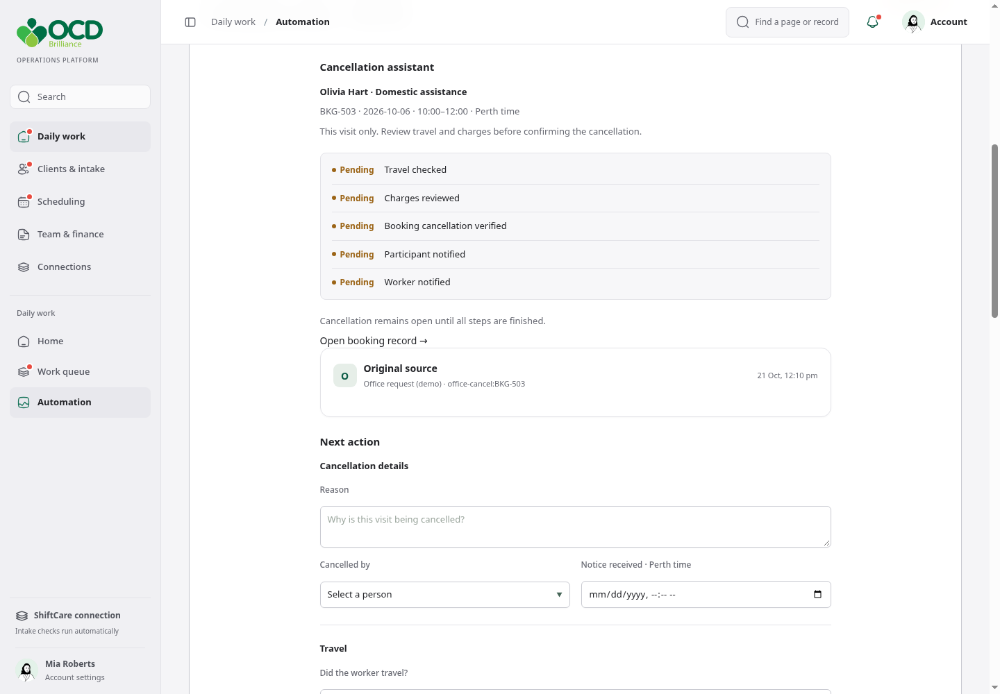
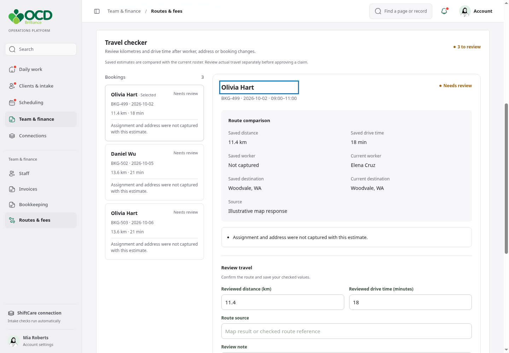
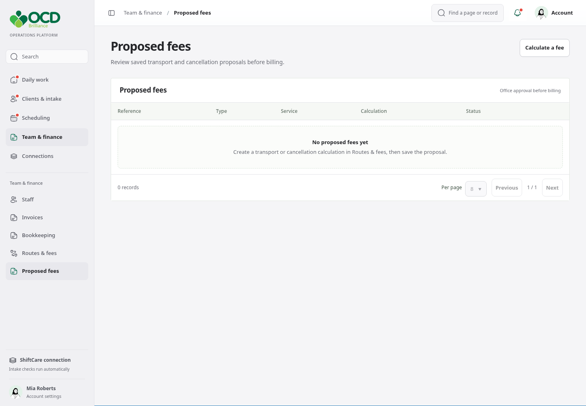
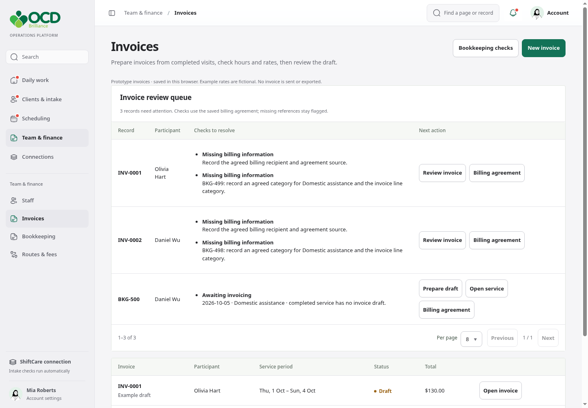
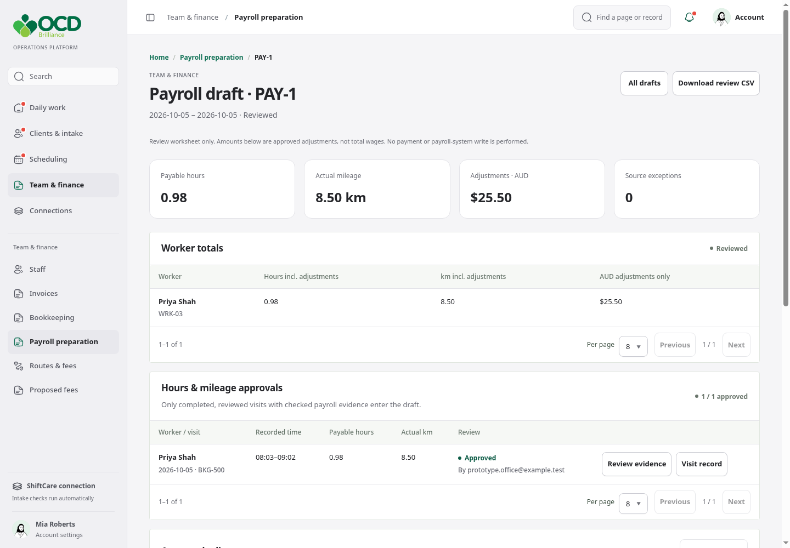
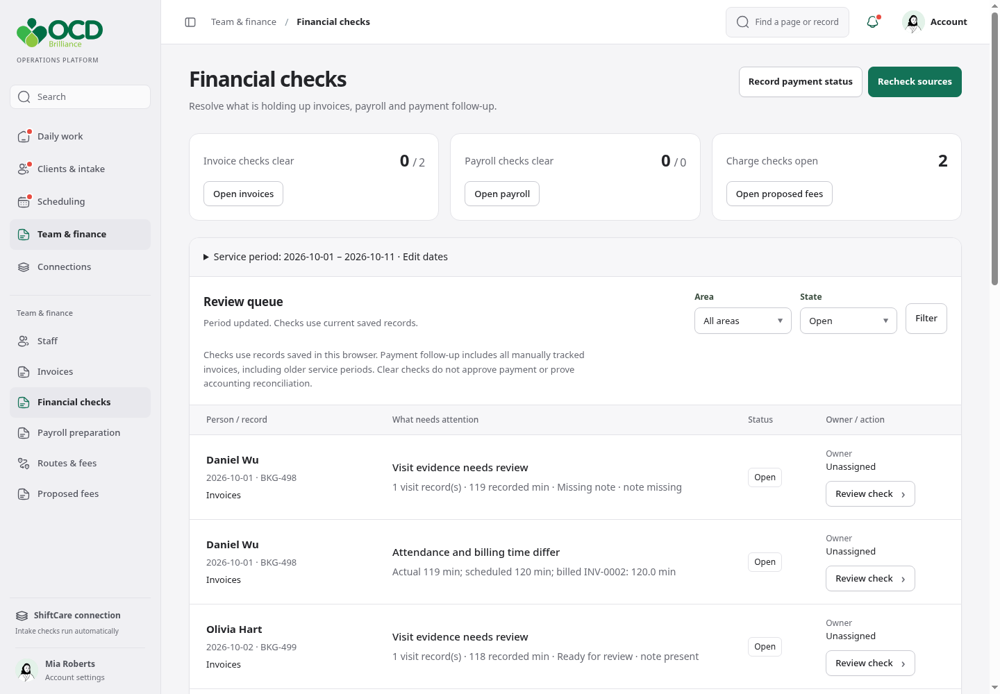
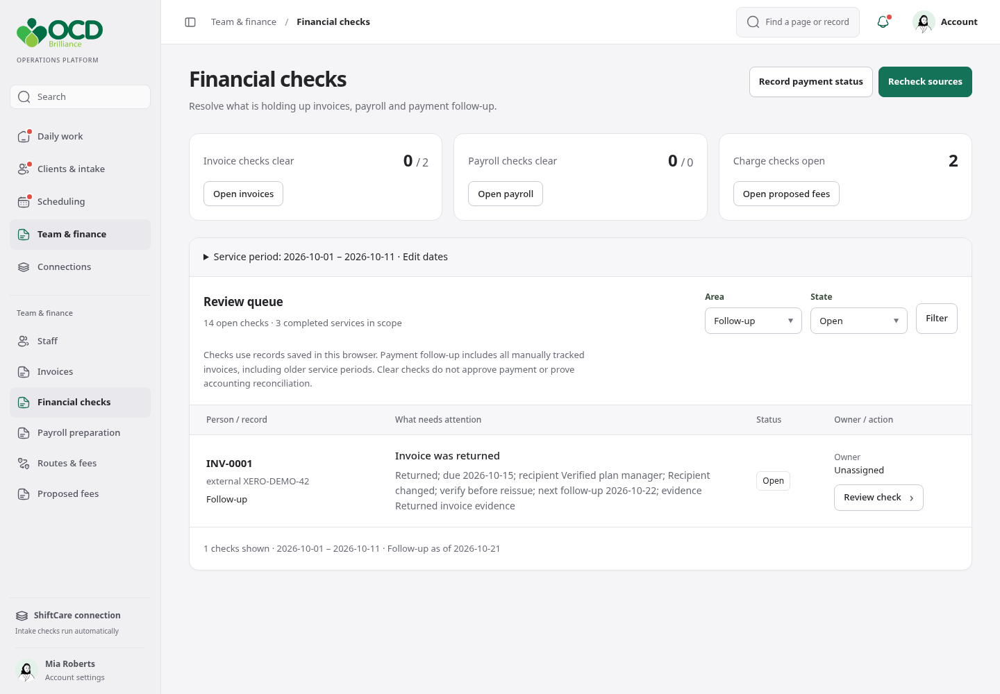

# OCD Brilliance: new features

**Study presentation and presenter guide**

Prepared 21 October 2026 · Office operations and bookkeeping

## The explanation to remember

These features bring scattered checks into one place, help staff record a reviewed decision, and show what still needs attention before invoicing or payroll.

Use this document to study the workflow, rehearse a demonstration, and answer questions about what the prototype actually does.

**Presentation length:** 12–15 minutes. Use fictional records throughout.

**Current scope:** a locally verified prototype. Most operational records are saved in the browser. Screenshots demonstrate behavior with sample records; they do not establish a live accounting or payroll integration.

# 01 · Why these features exist

The meetings described repeated checking across ShiftCare, notes, billing records and payroll entry. The purpose is to reduce searching and prevent missed discrepancies.

| Meeting problem | Feature that addresses it |
|---|---|
| Cancellation needs charge/travel checks and updates to people | Cancellation assistant |
| Worker, address or booking changes can invalidate travel | Travel checker |
| Proposed charges were hard to find | Dedicated Proposed fees page |
| Bookkeeper opens shifts to compare time and billing details | Invoice review and Financial checks |
| Payroll requires worker-by-worker hours, mileage and adjustments | Payroll preparation |
| Returned invoices and recipient changes need follow-up | Payment follow-up in Financial checks |

**Say:** “We are helping the office prepare and verify the work before it reaches the financial systems.”

**Study check:** Which problem is searching for discrepancies, and which problem is deciding the correct financial treatment? The product helps with both, but a finding alone is not an approval.

# 02 · How the features fit together

**Visit and booking records → specific checks → staff correction or evidenced explanation → reviewed drafts → existing financial process.**

| Place | Its purpose | Its output |
|---|---|---|
| Financial checks | Find what is holding up work | Actionable findings with owners |
| Invoices | Prepare and review service billing | Reviewed local invoice draft |
| Payroll preparation | Assemble approved pay inputs | Reviewed payroll worksheet and CSV |
| Routes & fees | Check route estimates and calculate proposals | Checked route or saved charge proposal |
| Proposed fees | Find and approve saved charge proposals | Recorded office approval |

**Important distinction:** Financial checks is the worklist. The source pages are where staff correct and review the underlying records.

**Say:** “Start with the issue, open the matching record, make the correction, then recheck. Staff should not have to reconstruct the same problem in another checklist.”

**Study check:** Where would you correct a billing recipient? In the invoice/billing record, then return to Financial checks.

# 03 · Cancellation assistant

**Problem:** A cancellation can leave travel charges, financial decisions or communication steps unfinished.

**Open:** Scheduling → Team schedule → a booking → Cancellation assistant.

**Demonstrate:** Check the exact occurrence and reason, review notice and travel evidence, record the charge treatment, perform the labelled demo cancellation, and verify the remaining handoffs.

{page=portrait}

**Say:** “This keeps the cancellation together, including the checks that are easy to miss afterward.”

**Watch for:** An unresolved communication or native-system exception keeps the case open. Approval applies to the reviewed occurrence and evidence. This prototype does not establish an automatic live cancellation or notification service.

# 04 · Travel checker

**Problem:** A saved route can become unreliable after a worker, address, booking or preceding visit changes.

**Open:** Team & finance → Routes & fees → Routes → Travel checker.

**Demonstrate:** Select a flagged booking, compare saved and current context, enter checked distance/time and a route reference, then save the review. If travel exceeds the available gap, record the scheduling outcome.

{page=portrait}

**Say:** “We flag when a saved estimate needs another look. We do not silently treat it as a worker’s actual mileage claim.”

**Study check:** Does approving a route approve payroll mileage? No. Actual mileage needs its own evidence and approval.

# 05 · Proposed fees gets its own page

**Problem:** Saved transport and cancellation proposals were buried beneath calculation screens.

**Open:** Team & finance → Proposed fees.

**Demonstrate:** Save a calculation from Routes & fees, open the proposal, inspect the inputs and rule reference, and record an approved amount and review reason.

{page=portrait}

**Say:** “Calculating a charge and approving it are separate steps. This page is where the office finds saved proposals and records its decision.”

**Watch for:** A proposal is not an invoice. Approval here does not automatically insert a charge into accounting or establish that the amount is billable under a current agreement.

# 06 · Invoice review

**Problem:** Completed services, billing recipients, categories and time differences need checking before billing.

**Open:** Team & finance → Invoices.

**Demonstrate:** Review the queue, open an invoice or create a draft for an uninvoiced completed service, verify the billing agreement, then check service/category, agreed billable hours, rate source and recipient.

{page=portrait}

**Say:** “A completed visit still needs a billing decision. The draft brings the service lines and agreed billing details together for review.”

**Watch for:** Initial invoice hours use scheduled duration. Actual attendance can differ. Confirm the agreed billable treatment rather than assuming all recorded attendance should be invoiced. No invoice is sent from this prototype.

# 07 · Payroll preparation

**Problem:** Hours, mileage and adjustments were checked and entered worker by worker.

**Open:** Team & finance → Payroll preparation.

**Demonstrate:** Choose the period, approve time and actual mileage with references, prepare or refresh the draft, add approved adjustments, review worker totals, then mark reviewed and download the review CSV.

{page=portrait}

**Say:** “This prepares checked payroll inputs. Hours, kilometres and AUD adjustments stay in separate units.”

**Watch for:** Missing or changed source records block review/export. Refreshing retains the previous draft snapshot. The CSV is a review worksheet, not a certified payroll import. Wage rates, tax, super and pay release remain outside this feature.

# 08 · Financial checks replaces Bookkeeping

**Problem:** The old page mixed generic reminders and care checks without showing what was blocking financial work.

**Open:** Team & finance → Financial checks.

**Demonstrate:** Confirm the service period, read readiness counts, filter by area/state, and open one check. Compare recorded evidence with the required check, assign an owner, and open its source record.

{page=portrait}

**Say:** “This is the bookkeeper’s queue of specific discrepancies. It tells us what needs attention and where to fix it.”

**Watch for:** Rechecking resolves corrected findings and reopens changed ones. A legitimate time difference needs an evidenced explanation. A clear queue refers only to the records and checks in scope; it is not financial approval.

# 09 · Returned and overdue invoice follow-up

**Problem:** Returned invoices, changed plan managers and uncertain payment outcomes delay follow-up.

**Open:** Financial checks → Record payment status. Use the Follow-up filter to find outstanding items.

**Record:** Local invoice, external invoice reference, verified recipient, outcome, due date, next review date, evidence reference and next action.

{page=portrait}

**Say:** “We keep the follow-up visible and record who verified the outcome. The accounting system remains the source for actual payment status.”

**Watch for:** An issued record can become overdue; a returned invoice needs follow-up. A verified Paid or Closed outcome resolves the local finding and retains history. Saving a status does not send a reminder, contact a recipient or alter the invoice draft.

# 10 · Worked example: one visit, several decisions

**Fictional scenario:** A visit was scheduled for 120 minutes. Attendance records show 135 minutes. The worker records 8.5 actual kilometres. The invoice still contains 120 minutes.

| Step | What staff do | What the feature contributes |
|---|---|---|
| 1. Investigate | Check attendance and the reason for extra time | Financial checks shows the time difference |
| 2. Decide billing | Confirm the agreement and approved billable time | Invoice editor records the chosen hours; an evidenced explanation can document a legitimate difference |
| 3. Prepare payroll | Verify payable minutes, unpaid breaks and actual mileage | Payroll preparation keeps approved pay inputs separate from billing |
| 4. Recheck | Return after saving the source decisions | Findings resolve, remain open, or reopen according to current evidence |
| 5. Final review | Review the resulting drafts | Payroll CSV is available only for a current reviewed draft without exceptions |

**Do not assume:** 135 attended minutes automatically means 135 billable or payable minutes. The approved evidence determines each treatment.

**Say:** “The same visit can have different billing and payroll treatment. We preserve that distinction rather than using one number everywhere.”

# 11 · A 12-minute demonstration plan

| Time | Show | Explain |
|---|---|---|
| 0–1 min | Feature map | Their manual checks and how the pages connect |
| 1–3 min | Financial checks → one discrepancy | Recorded value, required check, owner and source link |
| 3–5 min | Invoice draft | Recipient, category, agreed time and rate source |
| 5–7 min | Payroll preparation | Approved inputs, adjustments and final review |
| 7–9 min | Travel checker → Proposed fees | Route estimate versus actual mileage; proposal versus invoice |
| 9–10 min | Cancellation assistant | Charge/travel review and unfinished handoffs |
| 10–11 min | Payment follow-up | Verified external status and the next action |
| 11–12 min | Recheck and questions | Source correction, reopening and prototype limits |

## Before you present

1. Use a fictional office session and confirm sample periods contain records.
2. Keep at least one discrepancy unresolved so you can demonstrate it.
3. Check the source links and have these screenshots available as a fallback.
4. Explain that changing records in the demo persists in that browser.

**Success test:** Ask the audience which record they would open next and what evidence they would need before approving it.

# 12 · Questions you should be ready to answer

**Does this replace the bookkeeper?** No. It organizes evidence and preparation; the bookkeeper still verifies financial treatment and uses the authoritative systems.

**Is Financial checks another accounting ledger?** No. It is a discrepancy and follow-up worklist connected to operational records.

**Can I just mark a problem done?** Source defects resolve through rechecking. Time differences may receive a checked, evidence-bound explanation. Changes to the compared records reopen that finding.

**Does a route estimate become payroll mileage?** No. Actual mileage is separately evidenced and approved.

**Are invoices sent or payslips released?** No. The local invoice and payroll workflows do not send invoices, release pay, calculate wage entitlements or update an external payroll system.

**How do we know it helps?** Technical checks establish the implemented behavior. Staff trials must establish whether it reduces searching, re-entry, mistakes or preparation time.

## Five-minute study exercise

Explain: the purpose of Financial checks; the difference between proposed fees and invoices; the evidence needed for actual mileage; why a resolved check can reopen; and what the CSV can and cannot do.

# 13 · Evidence and presenter boundaries

## Meeting evidence

- Original meeting transcript: discussion around **11:03:55–11:06:15** describes opening individual shifts, comparing times and notes, and preparing invoices. Around **11:42:56–11:43:09**, payroll checking includes hours, kilometres and travel.
- Later recording analysis, **M2 00:08:32–00:12:49**: employee-by-employee payroll entry and review. **M2 00:10:36–00:12:34**: adjustments, leave and back pay. **M2 00:19:38–00:22:10**: service/category and travel-item corrections. **M2 00:36:25–00:37:53**: returned invoices and plan-manager changes.
- The original discussion described Tuesday invoicing. Later discussion explored other timing; a definitive new production cadence was not established. Use an agreed period rather than promising a new schedule.

## What was verified

Financial checks: production build, 11 focused tests and an isolated desktop/mobile browser workflow passed. A final full-workspace run reported separate room-video API fixture failures; this is recorded in the verification notes. Screenshots are from fictional local records captured on 21 October 2026. Earlier feature screenshots are supporting demonstrations, not production acceptance tests.

## What still needs confirmation

Live accounting/payroll connections, payroll vendor/import format, authoritative billing and employment rules, production periods, secure roles, scheduled jobs and measurable staff time savings.

**Presenter closing line:** “The next step is to run a representative period with the bookkeeper, check the findings against the source systems, and measure whether the preparation work becomes easier.”
